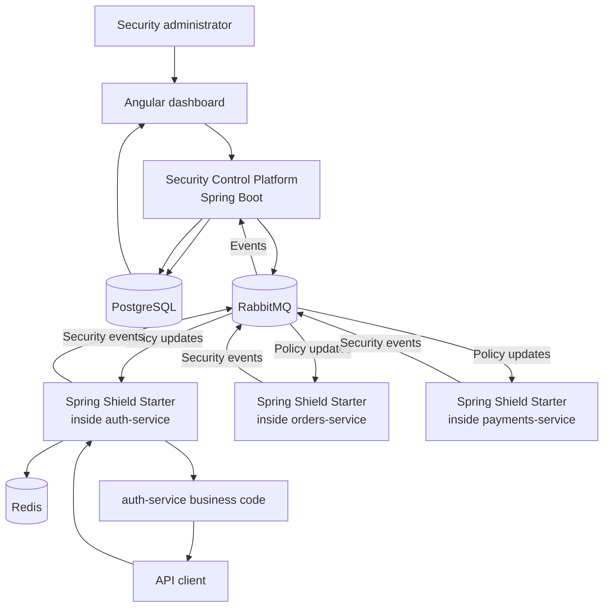

# Master handoff - Najim's PFE, learning plan, and setup context

This file consolidates the important decisions from this conversation. It is designed to be uploaded to another AI so that the AI can continue helping without needing the full chat history.

## 1. Student profile and working preferences

Najim is a final-year computer engineering student in Morocco preparing for a PFE/internship. His strongest and preferred area is Java, Spring Boot, backend development, microservices, DevOps, and security.

Relevant experience and skills include:

- Java 17 and Oracle Java certification;
- Spring Boot, Spring Cloud, Spring Security, REST APIs, Kafka, JUnit;
- PostgreSQL, MySQL, MongoDB, TimescaleDB;
- Docker, Kubernetes, Jenkins, GitHub Actions, Terraform;
- Keycloak, OAuth2/OIDC, Vault;
- SonarQube, Semgrep, Gitleaks, Trivy, Prometheus, Grafana;
- Python experience, but Java/Spring Boot should remain the center of the PFE.

He likes Python, but it must have a meaningful responsibility if used. Do not add Python only to make the stack look larger.

He does **not** want an AI, LLM, RAG, or autonomous-agent project.

He wants simple English explanations before technical depth. Define a technical term when first used and always give a concrete example. Do not assume that a complex title means he already understands the product.

## 2. Time and project constraints

The PFE has roughly three months available, but Najim also has:

- school and exams;
- an unfinished personal project with Kubernetes, Terraform, CI/CD, Semgrep, Trivy, Cosign, and related DevSecOps work;
- a separate QA automation project;
- French and English preparation;
- backend, DevOps, system-design, and interview study.

The PFE needs to look serious and useful to a company, but the core must be achievable first. Extra cloud and DevSecOps features come only after the main product works end to end.

## 3. Final PFE choice

**Project name:** Spring Shield RASP

**Suggested French title:**

> Conception et developpement d'une plateforme RASP distribuee pour la protection dynamique des microservices Spring Boot par politiques de securite et reponse en temps reel.

**Best one-sentence description:**

> My project lets security teams send new protection rules to live Spring Boot microservices without redeploying them.

**Simple description:**

Spring Shield RASP is a central security platform plus a reusable Spring Boot library. A security team creates rules centrally. Running Spring Boot services receive the rules, enforce them before processing requests, and report blocked activity back to the central platform.

RASP means Runtime Application Self-Protection:

- Runtime: while the application is running.
- Application: a Spring Boot microservice.
- Self-protection: the service can inspect and block a request before its normal business controller handles it.

This project is inspired by the runtime-protection and security-orchestration ideas visible in Ostorlab repositories, especially the mobile RASP direction, but it is a distinct server-side Java/Spring Boot product. It must not copy Ostorlab OXO, KEV, scanners, or mobile implementation.

## 4. The problem being solved

Companies often run multiple APIs:

```text
auth-service
orders-service
payments-service
profile-service
```

When a security team needs a new protection rule, the normal process is slow:

```text
Developer changes code
-> builds a Docker image
-> tests it
-> deploys it
-> restarts the service
```

Spring Shield RASP changes this process:

```text
Security admin changes a policy
-> policy is sent to running services
-> services enforce it on the next request
-> no source-code change, rebuild, or restart
```

The system does not modify Java code at runtime. It updates **policy data** stored in the protected service's memory.

## 5. The two main deliverables

### A. Security Control Platform

This is a central Java/Spring Boot application for security administrators. It manages:

- protected microservices;
- policy drafts;
- active policies and versions;
- incidents and security events;
- audit logs;
- environments such as development, staging, and production;
- emergency protection rules.

### B. `spring-shield-starter`

This is a reusable Java/Spring Boot Starter library installed inside a protected service.

It should:

- install a request filter before application controllers;
- read the active policy from local memory;
- inspect the endpoint, HTTP method, authenticated role, source identity, and counters;
- allow, deny, rate-limit, or log the request;
- publish security events to RabbitMQ;
- receive policy update notifications;
- keep enforcing the last valid cached policy if the central platform is temporarily unavailable.

The starter is the most important deliverable. It is a Java library, not a scanner or AI agent.

## 6. Important policy examples

A policy is a security rule with:

```text
Scope: Which service and environment?
Target: Which endpoint and HTTP method?
Condition: When does it trigger?
Action: What happens?
Version: Which active policy version is this?
```

### Policy 1: failed-login protection

```text
Service: auth-service
Environment: production
Endpoint: POST /login
Condition: More than 5 failed login attempts from one IP in 60 seconds
Action: HTTP 429 Too Many Requests for 10 minutes
```

Flow:

```text
Failed attempts 1 to 5 -> auth-service returns login failure
Each failure increments a Redis counter
Attempt 6 -> Spring Shield checks counter before controller runs
Attempt 6 -> HTTP 429; login controller is not called
Spring Shield -> RabbitMQ security event -> Control Platform incident
```

The implementation detail matters: the starter needs to know whether login failed. It can inspect the final response status, for example HTTP 401, after the login request returns. On a successful login, the chosen design can reset the consecutive-failure counter.

### Policy 2: endpoint rate limit

```text
Service: payments-service
Endpoint: POST /api/payments
Condition: More than 10 requests per authenticated user in one minute
Action: HTTP 429
```

Redis stores counters so that several instances of the same service use one shared limit.

### Policy 3: role protection

```text
Service: profile-service
Endpoint: DELETE /api/users/{id}
Condition: Current authenticated role is not ADMIN
Action: HTTP 403 Forbidden
```

Normal permanent authorization should remain in Spring Security. Spring Shield adds a dynamic supplementary layer, especially useful for emergency protection.

### Policy 4: emergency endpoint block

```text
Service: orders-service
Environment: production
Endpoint: POST /api/orders/export
Condition: Any request
Action: DENY
```

This lets the security team block a risky endpoint immediately without waiting for a deployment.

## 7. Runtime policy update

Example: the active login policy blocks after five failures. The security administrator changes it to three.

```text
1. Administrator edits the policy in the dashboard.
2. Control Platform validates it.
3. Control Platform stores policy version 2 in PostgreSQL.
4. Control Platform activates version 2.
5. Control Platform sends policy.updated event through RabbitMQ.
6. auth-service receives notification.
7. Spring Shield fetches or receives policy version 2.
8. Spring Shield validates it and atomically replaces version 1 in memory.
9. New requests now use version 2.
```

No service restart occurs.

Policy updates should use version numbers. If a late message for version 1 arrives after version 2, the service ignores it.

At startup, every service fetches the current active policy from the Control Platform. It must not rely only on old RabbitMQ notifications.

## 8. Architecture



### Component responsibilities

| Component | Role |
|---|---|
| Control Platform | Policies, versions, protected-service registration, events, incidents, audit logs. |
| Spring Shield Starter | Runtime enforcement inside every protected Spring Boot service. |
| PostgreSQL | Source of truth for policies, versions, incidents, and audit logs. |
| RabbitMQ | Policy-update notifications and security-event delivery. |
| Redis | Distributed rate-limit and failed-login counters. |
| Angular dashboard | Policy and incident interface. Keep it simple. |
| Demo services | `auth-service` and `orders-service` for MVP. Add `payments-service` later only if time remains. |
| Docker Compose | Local execution of the complete system. |

## 9. Required stack

### Core

- Java 17
- Spring Boot
- Spring Security
- Spring MVC `OncePerRequestFilter` as the first request-interception mechanism
- PostgreSQL
- RabbitMQ
- Redis
- Angular
- Docker Compose
- JUnit 5
- Testcontainers

### Optional after the MVP

- GitHub Actions
- Kubernetes with Kind or Minikube
- Helm
- Prometheus and Grafana
- Keycloak
- Semgrep, Trivy, Gitleaks, Cosign, SBOM
- Terraform
- Python traffic simulator for a controlled final demo

Python is optional. Keep Java/Spring Boot central.

## 10. RabbitMQ and Redis

### RabbitMQ

RabbitMQ has two separate flows.

```text
Control Platform -> RabbitMQ -> protected services
```

This announces policy updates.

```text
Protected services -> RabbitMQ -> Control Platform
```

This carries blocked-request and security events.

An event must include safe metadata only:

```text
eventId
service name
environment
policy name and version
endpoint and HTTP method
action taken
timestamp
privacy-safe source identifier
```

Never include passwords, full JWTs, session IDs, or full request bodies.

### Redis

Redis holds fast shared counters. Example key:

```text
shield:auth-service:failed-login:hashed-ip:current-window
```

For a robust rate limit, use an atomic Redis operation, such as Lua script or an atomic counter strategy, so two concurrent requests cannot both pass the same limit by mistake.

## 11. Reliability rules

These requirements make the project technically serious:

1. Policy checks should be fast because they run for every protected request.
2. Services use a local in-memory cache of the last valid policy.
3. If RabbitMQ is unavailable, local protection still works.
4. If the Control Platform is unavailable, services use their last valid policy.
5. A restarted service fetches the active policy at startup.
6. Rate-limit counters stay shared across several replicas through Redis.
7. RabbitMQ can redeliver messages, so event processing must be idempotent.
8. A duplicate security event must not create two incidents.
9. Every policy change needs an audit record.
10. Logs and events must not leak credentials or sensitive request content.

### Redis outage decision for MVP

For normal endpoints, choose:

```text
Redis unavailable -> allow request -> log internal security-system error
```

Later, a strict mode can block selected critical endpoints when Redis is unavailable.

### Policy conflict decision

Recommended priority:

```text
Emergency DENY
-> normal DENY
-> RATE_LIMIT
-> LOG
-> default ALLOW
```

## 12. MVP scope

The mandatory first version is:

1. `auth-service` demo application with `POST /login`.
2. `orders-service` demo application with one sensitive endpoint.
3. `spring-shield-starter` request filter.
4. Redis-backed failed-login policy.
5. Redis-backed endpoint rate-limit policy.
6. RabbitMQ security-event publication.
7. Control Platform receiving and storing incidents in PostgreSQL.
8. Policy storage and policy versioning.
9. Dynamic policy update without restarting `auth-service`.
10. Docker Compose startup.
11. Simple Angular dashboard for policies and incidents.
12. Meaningful automated tests.

The first milestone is:

```text
Six failed logins are sent to auth-service.
The sixth request receives HTTP 429.
Spring Shield publishes a security event to RabbitMQ.
Control Platform stores and exposes the incident.
```

Only after this works should additional cloud/DevSecOps features be added.

## 13. Test plan

### Policy engine

- Policy matches only correct service, endpoint, method, and environment.
- Disabled or expired policy does nothing.
- Invalid policy cannot activate.
- Deny rule wins over allow rule.
- Invalid threshold/action/endpoint is rejected.

### Login and rate limiting

- Requests below the limit are allowed.
- Request above limit receives HTTP 429.
- Blocked request never reaches the service controller.
- Different identities have separate counters.
- Counter expires after configured time window.
- Successful login resets counter if using consecutive-failure semantics.
- Several service instances share the same Redis counter.
- Concurrent requests cannot bypass a limit.

### Role and emergency policies

- Admin may use allowed endpoint.
- Employee is denied with HTTP 403.
- Emergency endpoint block applies immediately.
- Emergency policy applies only to selected environment.
- Removing policy restores normal behavior.

### Dynamic updates

- Service loads current policy at startup.
- Activated version is received without restart.
- Next request follows new policy.
- Duplicate or old update message is ignored safely.
- Service keeps cached policy during Control Platform/RabbitMQ outage.

### RabbitMQ events

- Blocked request emits one event.
- Event does not contain credentials.
- Duplicate event ID creates one incident only.
- RabbitMQ outage does not crash protected service.

### Audit, resilience, performance

- Policy creation, change, activation, and deletion are audited.
- Service restart restores protection.
- Central-platform restart does not remove local enforcement.
- Policy filter overhead stays small under normal requests.

## 14. 12-week roadmap

| Week | Main result |
|---|---|
| 1 | Project requirements, architecture, ERD, Docker Compose skeleton. |
| 2 | Build `auth-service` and `orders-service` demo services. |
| 3 | Create `spring-shield-starter` and request filter. |
| 4 | Implement Redis failed-login protection. |
| 5 | Add RabbitMQ security-event publication. |
| 6 | Build Control Platform event consumer and PostgreSQL storage. |
| 7 | Build policy/version API and dynamic update without restart. This is the major milestone. |
| 8 | Add simple Angular policy and incident dashboard. |
| 9 | Add endpoint rate limit, role policy, and emergency endpoint block. |
| 10 | Add audit logs, duplicate-event handling, and recovery tests. |
| 11 | Add GitHub Actions and optional security/DevOps tools only if core is stable. |
| 12 | Demo, report, architecture diagrams, presentation, and fixes. |

## 15. Work split with teammate

Najim owns every important security/runtime part. The teammate knows basic Spring Boot monolithic CRUD and should receive a bounded task that cannot block the project.

### Najim owns

- `spring-shield-starter`;
- request interception and policy engine;
- Spring Security integration;
- Redis counters and rate limiting;
- RabbitMQ configuration, events, and dynamic updates;
- policy activation/versioning logic;
- incident processing;
- Docker Compose, integration, tests, CI/CD, documentation, and final demo.

### Teammate owns

Build a simple Spring Boot Policy Management CRUD module:

```text
ProtectedService CRUD
PolicyDraft CRUD
Validation
PostgreSQL persistence
Swagger/OpenAPI documentation
Basic controller/service/repository tests
```

Suggested endpoints:

```text
POST   /api/services
GET    /api/services
PUT    /api/services/{id}
DELETE /api/services/{id}

POST   /api/policy-drafts
GET    /api/policy-drafts
GET    /api/policy-drafts/{id}
PUT    /api/policy-drafts/{id}
DELETE /api/policy-drafts/{id}
```

The teammate must not own RabbitMQ, Redis, security filters, dynamic activation, or runtime incident processing.

## 16. Final demonstration

```text
1. Start PostgreSQL, RabbitMQ, Redis, Control Platform, auth-service, and orders-service with Docker Compose.

2. Open the dashboard. No incidents are present.

3. Activate policy: block after five failed login attempts in one minute.

4. Send six failed logins.

5. Show sixth request receives HTTP 429.

6. Show incident appears in dashboard through RabbitMQ.

7. Change policy from five failures to three failures.

8. Do not restart auth-service.

9. Show fourth failed login is now blocked.

10. Activate emergency rule blocking POST /api/orders/export in production.

11. Show endpoint is blocked and event is recorded.
```

## 17. Interview explanation

### Short English

> Spring Shield RASP is a runtime security platform for Spring Boot microservices. A central platform manages versioned security policies, while a reusable starter library enforces them inside running services. It can update rate limits or block sensitive endpoints without redeploying services.

### Why it is useful

> During a security incident, code changes and deployments take time. This platform lets a security team react immediately by distributing an emergency policy to live services and keeping an audit trail of what was blocked and why.

### Why RabbitMQ

> RabbitMQ separates the Control Platform from protected services. It distributes policy-update notifications and carries security events back to the platform without requiring synchronous communication for every request.

### Why Redis

> Redis stores shared counters. If several auth-service instances receive login requests, they must see the same failed-login count. Otherwise, a limit could be bypassed by reaching different instances.

### Honest limitation

> Spring Shield RASP enforces configured rules. It does not automatically discover every attack, replace secure coding, or replace Spring Security.

## 18. Obsidian setup status

The Obsidian vault is located at:

```text
C:\Users\HP\Desktop\najimlap
```

The Copilot community plugin was installed in the vault:

```text
C:\Users\HP\Desktop\najimlap\.obsidian\plugins\copilot
```

Installed version:

```text
Copilot 4.0.19
```

The user must manually finish these security-sensitive steps in Obsidian:

```text
Settings -> Community plugins -> turn off Restricted Mode -> enable Copilot
Settings -> Copilot -> choose Codex and sign in
Settings -> General -> enable Command line interface if Copilot requests it
```

The plugin was installed, but it was not enabled automatically because enabling community plugins and running a third-party plugin requires user action.

## 19. ChatGPT account-transfer information

An existing ChatGPT conversation cannot be moved into another account's normal chat history or sidebar.

To keep the conversation as reference in another personal account:

```text
Current account -> Settings -> Data controls -> Export data
Download export ZIP from email/SMS
Extract ZIP
Find conversations.json
New account -> create a new chat -> upload conversations.json
```

The uploaded file is available as reference in the new conversation. It does not merge accounts, recreate the old sidebar, transfer memory, or move a subscription.

For this project, this Markdown file can be uploaded directly to another AI instead of transferring the entire chat history.

## 20. Instructions for another AI

Use this document as the source of truth.

1. Explain concepts in simple English before giving code.
2. Build the MVP first and keep Java/Spring Boot central.
3. Do not convert the project into a QA automation product, generic WAF, CVE scanner, AI project, or copy of an Ostorlab project.
4. Do not add Kubernetes, Terraform, Keycloak, Prometheus, Grafana, GitHub Actions, Python, or extra services before the end-to-end MVP works.
5. Start with the first vertical slice: auth-service, Spring Shield filter, Redis failed-login counter, RabbitMQ event, Control Platform consumer, PostgreSQL incident.
6. Explain the architecture as control plane versus protected runtime.
7. Include unit tests, integration tests, and end-to-end tests from the beginning.
8. Never log sensitive credentials or full request bodies.
9. Be realistic about the three-month time limit.
10. Help Najim understand the reasoning behind every architectural decision so he can draw and defend the architecture himself.

