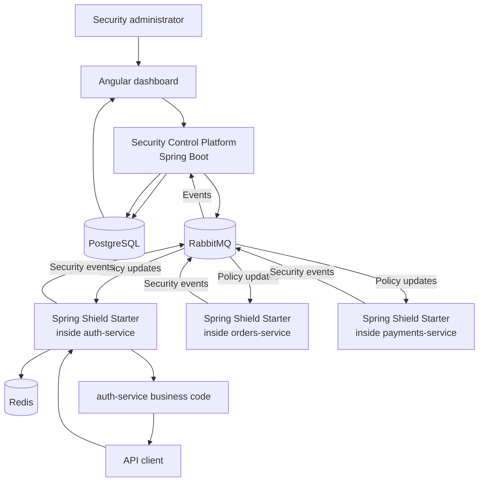

# Spring Shield RASP - PFE project context for an AI assistant

## Project identity

**Suggested product name:** Spring Shield RASP

**Suggested French PFE title:**

> Conception et developpement d'une plateforme RASP distribuee pour la protection dynamique des microservices Spring Boot par politiques de securite et reponse en temps reel.

**One-sentence definition:**

> A central security platform that sends protection policies to running Spring Boot microservices; each microservice can enforce those policies immediately and report blocked activity back to the platform.

**Simple elevator pitch:**

> I am building a runtime security platform for Spring Boot microservices. A security team can change protection rules, such as login limits or emergency endpoint blocks, without rebuilding or redeploying services. The protected services enforce those rules in real time and report security incidents centrally.

---

## The problem it solves

Companies often have many backend services:

```text
auth-service
orders-service
payments-service
profile-service
```

Each service has its own security-related code. When a new threat appears, or when the security team needs to tighten a limit, the normal process is slow:

```text
Change Java code -> build image -> test -> deploy -> restart service
```

This project enables a different response:

```text
Security admin changes policy in dashboard
        -> policy is distributed to running services
        -> the next request follows the new policy
        -> no code change, image rebuild, or service restart
```

The project does not change Java source code during runtime. It changes **policy data stored in memory** inside each protected service.

---

## What RASP means

RASP means **Runtime Application Self-Protection**.

- **Runtime:** while the application is running.
- **Application:** the Spring Boot microservice itself.
- **Self-protection:** the service checks and can block requests before its business code processes them.

Ostorlab has a RASP repository for mobile applications. This project takes inspiration from runtime protection but creates a distinct server-side product for Java/Spring Boot microservices.

The platform should be described honestly:

> It supplements normal Spring Security rules with centrally managed, dynamic runtime policies. It does not replace secure coding, Spring Security, code review, or a WAF.

---

## The two main products being built

### A. Security Control Platform

This is the central Spring Boot application used by security administrators.

It lets them:

- register protected microservices;
- create, activate, deactivate, and version policies;
- select an environment such as development, staging, or production;
- see security events and incidents;
- see which policy version every service is using;
- review audit history: who changed what and when;
- create emergency protection policies without redeploying services.

### B. Spring Shield Starter

This is a reusable Java/Spring Boot library, for example:

```text
spring-shield-starter
```

A developer adds it as a dependency to a protected microservice.

The library:

- installs a filter before Spring controllers receive requests;
- reads the active policy from local memory;
- checks endpoint, HTTP method, authenticated role, source identity, and rate-limit counters;
- allows, blocks, rate-limits, or logs a request;
- sends security events to the central platform through RabbitMQ;
- receives policy-update notifications;
- keeps the last valid policy if the central platform is temporarily unavailable.

The starter is a Java library. It is not an AI agent and not a scanner agent.

---

## Concrete examples

### Example 1 - Brute-force login protection

The security admin creates a policy:

```text
Service: auth-service
Endpoint: POST /login
Condition: more than 5 failed logins from one source within 60 seconds
Action: block for 10 minutes
```

The protected `auth-service` checks Redis before processing each login.

```text
Attempts 1 to 5 -> processed normally
Attempt 6 -> blocked with HTTP 429 Too Many Requests
```

The service publishes an event:

```text
Service: auth-service
Policy: failed-login-limit
Action: blocked
```

The Control Platform stores and displays the incident.

### Example 2 - Dynamic policy update

The current policy blocks after five failed logins. During an incident, the security admin changes it to three.

```text
Old policy: block after 5 failures
New policy: block after 3 failures
```

The new policy is activated and distributed through RabbitMQ. The running service updates the policy in memory. The next request follows the new limit. The service was never restarted.

### Example 3 - Sensitive endpoint protection

The company has:

```text
DELETE /api/users/{id}
```

A policy states that only `ADMIN` users may call it.

```text
Current role: EMPLOYEE
Required role: ADMIN
Result: HTTP 403 Forbidden
```

The event is saved as evidence for the security team.

### Example 4 - Emergency endpoint block

The team discovers a dangerous endpoint in production:

```text
POST /api/orders/export
```

The security administrator creates a temporary emergency rule:

```text
Block POST /api/orders/export in production
```

The protected order service receives the new policy and blocks this endpoint without a code deployment.

### Example 5 - Payment endpoint rate limiting

The security team limits payment requests:

```text
Service: payments-service
Endpoint: POST /api/payments
Limit: 10 requests per user per minute
Action: HTTP 429 after the limit
```

Redis stores the request counter so the limit remains correct even if there are several instances of `payments-service`.

---

## What happens during a normal request

```text
Client sends a request
        ↓
Spring Shield filter receives it before the Spring controller
        ↓
Starter reads active local policy from memory
        ↓
Starter checks route, method, user role, and Redis counter when needed
        ↓
Decision: allow, block, rate-limit, or log
        ↓
If allowed, the real Spring Boot controller runs
If blocked, the controller never runs
        ↓
If a meaningful event happened, the starter publishes it to RabbitMQ
```

Suggested actions for the first version:

| Action | Meaning |
|---|---|
| `ALLOW` | Continue to the normal controller. |
| `LOG` | Allow request but send security observation to the platform. |
| `DENY` | Refuse request with HTTP 403 Forbidden. |
| `RATE_LIMIT` | Refuse request with HTTP 429 Too Many Requests. |

---

## How runtime policy changes work

The service does not receive new Java code. It receives new policy data.

```text
1. Security admin changes a rule in dashboard.
2. Control Platform validates and saves policy version 12 in PostgreSQL.
3. Control Platform publishes a `policy.updated` notification to RabbitMQ.
4. Spring Shield Starter receives the notification.
5. Starter fetches or receives policy version 12.
6. Starter validates it and atomically replaces version 11 in local memory.
7. New requests use version 12. Requests already in progress can finish with version 11.
```

At service startup, the starter must fetch the current active policy from the Control Platform. This prevents a newly started service from waiting for an old RabbitMQ message.

If RabbitMQ or the Control Platform is down, the service continues using its last valid cached policy. It must not lose all protection merely because the central platform is unavailable.

---

## Architecture



### Component responsibilities

| Component | Technology | Responsibility |
|---|---|---|
| Control Platform | Java 17, Spring Boot | Policies, protected-service registration, incidents, audit logs, policy versions. |
| Spring Shield Starter | Java 17, Spring Boot Starter | In-process request enforcement inside services. |
| PostgreSQL | PostgreSQL | Policies, versions, services, events, incidents, and audit logs. |
| RabbitMQ | RabbitMQ | Policy notifications and security events. |
| Redis | Redis | Shared counters for failed login and rate-limit rules. |
| Dashboard | Angular | Policy management and incident visualization. |
| Demo services | Spring Boot | `auth-service` and `orders-service` for demonstration. Add `payments-service` only if time remains. |
| Local deployment | Docker Compose | Runs the full project locally. |

---

## RabbitMQ role

RabbitMQ has two real jobs.

### Policy update path

```text
Control Platform -> RabbitMQ -> protected service starters
```

Example event:

```json
{
  "type": "policy.updated",
  "service": "auth-service",
  "environment": "production",
  "policyVersion": 12,
  "occurredAt": "2026-11-07T10:00:00Z"
}
```

### Security event path

```text
Protected service starter -> RabbitMQ -> Control Platform
```

Example event:

```json
{
  "type": "security.request.blocked",
  "service": "auth-service",
  "environment": "production",
  "policyVersion": 12,
  "policyName": "failed-login-limit",
  "action": "RATE_LIMIT",
  "endpoint": "POST /login",
  "occurredAt": "2026-11-07T10:01:15Z"
}
```

Never include passwords, JWTs, session identifiers, or full request bodies in messages or logs.

---

## Technology choices

### Required stack

- Java 17
- Spring Boot
- Spring Security
- Spring MVC `OncePerRequestFilter` for the first starter implementation
- PostgreSQL
- RabbitMQ
- Redis
- Angular
- Docker Compose
- JUnit 5
- Testcontainers for integration tests

### Optional stack after the core works

- GitHub Actions
- Kubernetes with Kind, Minikube, or a local cluster
- Helm charts
- Prometheus and Grafana
- Keycloak for dashboard authentication
- Semgrep, Trivy, Gitleaks, Cosign, SBOM generation
- Terraform

### Python

Python is optional. Do not add it only to make the stack look larger.

If Python is desired, use it after the Java core works for a small, safe traffic simulator that generates controlled login and API activity for the final demonstration. It is not the core of the product.

---

## Suggested data model

| Entity | Important fields |
|---|---|
| `ProtectedService` | id, name, environment, status, latestPolicyVersion |
| `SecurityPolicy` | id, name, policyType, serviceId, environment, active |
| `PolicyVersion` | id, policyId, versionNumber, ruleDefinition, createdBy, activatedAt |
| `SecurityEvent` | id, serviceId, policyVersionId, endpoint, actionTaken, occurredAt |
| `Incident` | id, severity, status, securityEventId, assignedTo |
| `AuditLog` | id, actor, action, resourceType, resourceId, timestamp |
| `RuntimeInstance` | id, serviceId, instanceName, lastHeartbeat, activePolicyVersion |

Keep personal and sensitive request data out of the database. If a source needs tracking, store a hash or a privacy-safe identifier.

---

## Reliability and security requirements

The difficult engineering value of this project is making it reliable.

1. **Low latency:** policy checks must be fast because they run before each protected request.
2. **Local policy cache:** a service uses in-memory policy data for fast checks.
3. **Policy consistency:** every service needs the right active policy version.
4. **Startup recovery:** a restarted service fetches the current policy.
5. **Control-plane outage:** services keep enforcing their last valid policy.
6. **Distributed counters:** Redis makes rate limits correct across service replicas.
7. **Duplicate RabbitMQ events:** Control Platform processing must be idempotent so one event does not create duplicate incidents.
8. **Timeouts and retry policy:** failures must be visible and controlled.
9. **Audit trail:** policy modifications must be traceable.
10. **Sensitive logging:** do not record passwords, access tokens, or full request bodies.

---

## First MVP scope

The core project must be finished before adding cloud or DevSecOps extras.

### Mandatory MVP

1. Control Platform Spring Boot application.
2. PostgreSQL policy storage and versioning.
3. `spring-shield-starter` Java library.
4. Two demo services: `auth-service` and `orders-service`.
5. RabbitMQ policy notifications and security event messages.
6. Redis failed-login counter.
7. Failed-login protection policy.
8. Endpoint rate-limit policy.
9. Simple Angular dashboard showing policies and incidents.
10. Dynamic policy change without service restart.
11. Docker Compose startup instructions.
12. Unit, integration, and end-to-end tests.

### Strong additions after MVP

1. Role-based endpoint rule.
2. Emergency endpoint block.
3. Policy history and rollback.
4. Audit log.
5. Multiple instances of one service.
6. Environment separation.
7. GitHub Actions integration.

### Out of scope unless the core is complete

- AI, LLM, RAG, or autonomous systems.
- Building a generic WAF.
- Building Nmap, Nuclei, Trivy, or a full vulnerability scanner.
- Testing random external systems.
- Kubernetes, Terraform, Prometheus, Grafana, Cosign, and complex cloud deployment before MVP.
- Dozens of microservices.

---

## Suggested 12-week plan

| Week | Result |
|---|---|
| 1 | Project specification, architecture, data model, Docker Compose skeleton. |
| 2 | Build `auth-service` and `orders-service` demo services. |
| 3 | Create first `spring-shield-starter` filter that can allow or deny a request. |
| 4 | Implement failed-login protection with Redis. |
| 5 | Create Control Platform APIs for policies and versions. |
| 6 | Add RabbitMQ security-event flow. |
| 7 | Add dynamic policy update without restarting `auth-service`. This is the main milestone. |
| 8 | Add Angular dashboard for policies and incidents. |
| 9 | Add endpoint rate limiting and role-based rule. |
| 10 | Add audit logs, retry handling, and duplicate-event handling. |
| 11 | Add CI/CD and optional DevSecOps tools if the core is stable. |
| 12 | Final testing, report, demo, diagrams, presentation, and fixes. |

---

## Final demonstration scenario

1. Start Control Platform, RabbitMQ, Redis, PostgreSQL, `auth-service`, and `orders-service` with Docker Compose.
2. Open dashboard. There are no incidents.
3. Create and activate policy: block after five failed login attempts in one minute.
4. Send six failed login attempts to `auth-service`.
5. Show the sixth request receiving HTTP 429.
6. Show the incident appearing in the dashboard through RabbitMQ.
7. Change the policy to block after three failed attempts.
8. Without restarting `auth-service`, show that the fourth failed login is now blocked.
9. Create emergency policy: block `POST /api/orders/export` in production.
10. Call the endpoint and show it is blocked immediately.
11. Show policy version history and audit log.

---

## Interview explanations

### Simple English

> Spring Shield RASP is a runtime security platform for Spring Boot microservices. A central control platform manages security policies, and a reusable Spring Boot starter enforces those policies inside running services. The platform can change limits or block sensitive endpoints without redeploying services.

### Why it is useful

> During a security incident, waiting for a code change and deployment can take time. This platform lets a security team react immediately by distributing an emergency rule to live services, while keeping an audit trail of what was blocked and why.

### RabbitMQ explanation

> RabbitMQ is used for asynchronous communication. The Control Platform publishes policy-update notifications, and protected services publish security events. This keeps services decoupled and allows the platform to scale to several protected microservices.

### Redis explanation

> Redis stores fast shared counters. If three instances of auth-service receive login requests, they must all use the same failed-login count; otherwise an attacker could bypass a local limit by reaching different instances.

### Main technical challenge

> The difficult part is reliable dynamic enforcement: low latency, policy version synchronization, safe caching during platform outages, distributed rate limits, idempotent event processing, and privacy-safe security logs.

### Honest limitation

> The project does not automatically discover every attack or replace Spring Security. It enforces the policies configured by the organization and helps security teams react faster at runtime.

---

## Instructions for an AI helping with this project

Use the following context when asking another AI for help:

```text
I am building Spring Shield RASP, a PFE project. It is a distributed runtime security platform for Spring Boot microservices, not a QA test app and not an AI project.

The project has two parts:
1. A Spring Boot Security Control Platform that manages policies, policy versions, protected services, incidents, and audit logs.
2. A reusable Java library called spring-shield-starter. It runs inside protected Spring Boot services, intercepts requests before controllers, evaluates cached dynamic policies, allows/blocks/rate-limits requests, and publishes security events.

The stack is Java 17, Spring Boot, Spring Security, PostgreSQL, RabbitMQ, Redis, Angular, Docker Compose, JUnit, and Testcontainers. Kubernetes and DevSecOps extras come only after the MVP.

RabbitMQ sends policy-update notifications from the Control Platform to protected services and sends security events back. Redis stores distributed rate-limit and failed-login counters.

MVP policies: failed-login protection and endpoint rate limiting. The main required demonstration is changing a policy dynamically without restarting auth-service.

Explain every technical concept in simple English before giving code. Do not add AI, agents, vulnerability scanners, excessive microservices, or cloud complexity before the core works. Keep the design realistic for a three-month PFE. Start by helping me design and implement the MVP step by step.
```

---

## Collaboration rules for another AI

Treat this document as the project source of truth unless the student explicitly changes a decision.

1. Explain one concept at a time in simple English before proposing code.
2. Start with the MVP. Do not add Kubernetes, Terraform, Keycloak, Prometheus, Grafana, Python, GitHub Actions, or extra services until the required core works.
3. Do not turn this project into a QA automation tool, vulnerability scanner, generic WAF, AI project, or a copy of an existing Ostorlab project.
4. Keep Java and Spring Boot at the center of the project. The reusable `spring-shield-starter` is a key deliverable.
5. Keep the architecture small: one Control Platform, one reusable starter, PostgreSQL, RabbitMQ, Redis, and two demo services for the MVP.
6. When proposing a feature, explain its business value, its technical role, and whether it is MVP, a strong addition, or optional.
7. Prefer a working, tested vertical slice over many unfinished components.
8. Include meaningful tests for policy evaluation, Redis rate limiting, RabbitMQ events, dynamic policy updates, and service restart recovery.
9. Never log passwords, raw JWTs, session IDs, or complete sensitive request bodies.
10. Be honest about limitations. The platform enforces configured policies; it does not automatically detect every attack.

---

## Current starting point

The first feature to implement is a minimal vertical slice:

```text
1. Create auth-service.
2. Create spring-shield-starter.
3. Starter installs a OncePerRequestFilter.
4. Add one hardcoded local policy: block after five failed login attempts.
5. Store the shared counter in Redis.
6. Return HTTP 429 when the limit is reached.
7. Publish one `security.request.blocked` event to RabbitMQ.
8. Control Platform consumes the event and stores it in PostgreSQL.
9. Show the stored event through a simple REST endpoint.
```

After that works end to end, replace the hardcoded policy with a policy loaded from the Control Platform, then add dynamic updates through RabbitMQ.

**Definition of success for the first milestone:**

> Six failed login requests are sent to auth-service. The sixth request is blocked with HTTP 429, a RabbitMQ security event is emitted, and the Control Platform stores and returns the incident.

---

## Best short description

Use this sentence when describing the project:

> **My project lets security teams send new protection rules to live Spring Boot microservices without redeploying them.**

