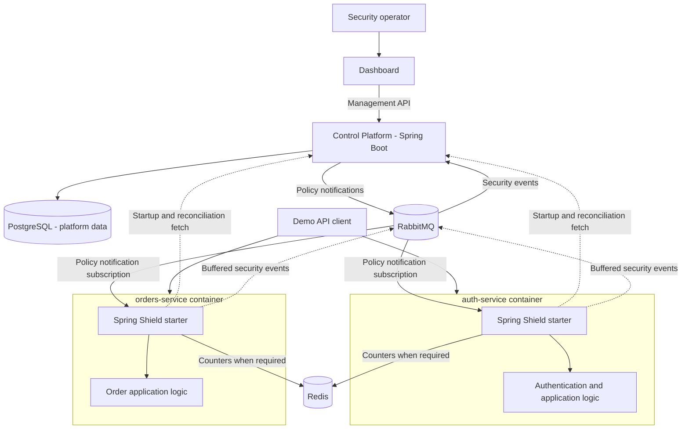
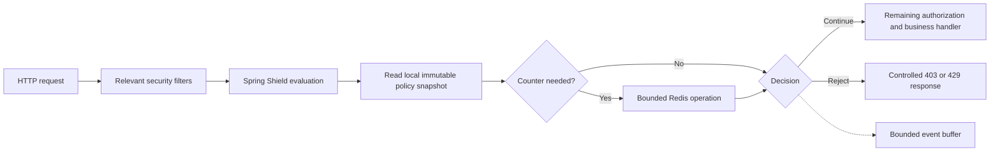

# Spring Shield — general architecture and demo system

Related: [[01 - Problems Risks and Protection Policies]] · [[03 - Engineering Work Tracker]]

> [!important] Proposal, not a frozen architecture
> This is a concrete picture for Najim to challenge and develop. The project notes previously proposed Spring Boot, RabbitMQ, Redis, PostgreSQL and Angular. Current user intent confirms a Spring Boot dependency, example microservices, RabbitMQ, Redis, containers and CI/CD. Exact versions, topology, frontend choice, policy semantics and failure behavior remain to be decided. No code is created by this document.

## The product boundaries

**Management side:** operators define and activate policies, inspect adoption status, and review security events. This is often called the control plane: it manages what should happen.

**Runtime side:** a library inside each service evaluates applicable requests and applies the current policy. This is the enforcement path: it decides what happens to this request.

The library is a Maven dependency packaged into the service. It is not a separate container, remote AI agent, gateway, or scanner. The management platform can be one modular Spring Boot application; it does not need to be split into many microservices just because the demo services are separate.

## Concrete demonstration domain: customer orders

| Component | Proposed operations | Reason to include it |
|---|---|---|
| `auth-service` | `POST /login` with a clearly defined authentication outcome | Demonstrates failed-login protection |
| `orders-service` | `GET /api/orders/{id}`, `POST /api/orders`, `POST /api/orders/export` | Supplies normal traffic, an expensive operation and emergency containment |
| Optional `payments-service` | `POST /api/payments` using fake transactions only | Optional extension for a distinct per-user limit |

Authentication mechanism and token validation are not selected here. A demo auth service must not become an excuse to invent production cryptography. Order ownership belongs to ordinary business authorization. Exports can use a small bounded dataset; the demonstration should not require deliberately vulnerable code.

Example story: a customer signs in, reads their order, and requests an export. An operator tightens the export limit, then temporarily disables export. Order reads remain available. The dashboard shows the policy version each instance adopted and the resulting block events.

## Container and communication view

Arrows represent responsibilities, not a guarantee that all operations are nonblocking. Redis operations can be synchronous on counter-based policies. The proposed event publisher decouples broker communication from request processing using a bounded buffer; its failure behavior still needs design.

## Component responsibilities

| Component | Owns | Does not own |
|---|---|---|
| Control Platform | Policy lifecycle, activation, service registry, desired versions, events, audit | Per-request permission calls for every service request |
| Starter | Request matching, local policy snapshot, evaluation, policy adoption, bounded event production | Business data ownership or universal exploit detection |
| RabbitMQ | Transport for update notifications and event delivery | Authoritative policy state or automatic exactly-once processing |
| Redis | Shared ephemeral counters and cooldown state | Durable policy definitions or business order records |
| PostgreSQL | Durable platform records | Direct browser access or per-request policy lookup |
| Dashboard | Operator views and actions through the API | Enforcement, database credentials |
| Demo services | Business behavior and existing security | Central policy administration |

If demo business data needs persistence, keep ownership separate from platform tables. For a local demo, separate databases or schemas can share one PostgreSQL server; that is not the same as services sharing each other's tables.

## Runtime request path

This is a conceptual path, not a final filter order. A role-based rule must execute after authentication has populated the trusted principal. Login throttling may need an early precheck and a separate authentication-outcome hook. A single incorrectly positioned filter cannot safely satisfy every requirement.

Spring Security documents that filter ordering determines what information is available and which downstream processing runs. Register the starter integration deliberately and avoid duplicate container and security-chain registration. Test normal, error and asynchronous dispatch behavior for the supported stack. [Spring Security servlet architecture](https://docs.spring.io/spring-security/reference/servlet/architecture.html)

The first scope may target Servlet/Spring MVC. Reactive WebFlux has different integration mechanisms and is not automatically supported by a servlet starter.

## Proposed internal starter modules

| Part | Purpose |
|---|---|
| Auto-configuration | Installs explicitly configured integration for supported Spring versions |
| Request context builder | Extracts normalized route, method, trusted identity and service scope |
| Policy validator/compiler | Checks policy data and prepares matchers outside the request path |
| Snapshot store | Exposes one complete immutable policy set to each evaluation |
| Policy evaluator | Produces allow/deny/rate-limit/observe decisions deterministically |
| Counter adapter | Implements atomic counter behavior and timeouts |
| Authentication outcome adapter | Records genuine login outcomes |
| Update client | Fetches and validates policy snapshots; handles adoption and reconciliation |
| Event publisher | Buffers minimal events with an explicit overflow policy |
| Metrics and health | Reports versions, failures, timing and event loss |

These are responsibilities, not a requirement for eleven packages or services.

## Proposed policy update path

1. The operator submits a draft through the management API.
2. The platform validates scope, rule types, thresholds and permissions.
3. Activation records a new desired policy-set revision in durable storage.
4. A notification identifies the service/environment and revision.
5. Each relevant instance obtains the complete current snapshot.
6. The instance validates it and swaps the local reference atomically.
7. The instance reports its applied revision or rejection reason.

Each request captures one snapshot for consistent evaluation. A request already admitted is not retroactively cancelled by a later update. “Next request uses the rule” means the next evaluation after that instance has adopted it, not instantly after the operator clicks Save.

**Database/message gap:** saving activation and publishing a message are two operations that can fail separately. A transactional outbox is one candidate: store an outgoing event alongside the activation, then retry publication. Reconciliation is still useful. This is an option to evaluate, not a completed reliability guarantee.

**Missed notifications:** startup fetch and periodic or reconnect reconciliation should retrieve the desired state. A running instance's memory survives a management outage, but not a process restart. A disk-backed last-valid snapshot would be an additional feature requiring integrity and staleness rules.

**Rollback:** a safer revision scheme publishes the earlier rule content as a new, higher revision. Simply sending an old revision conflicts with rejection of stale messages.

## RabbitMQ topology decision that matters

Policy updates and security events have different delivery needs:

- Every live protected instance must learn about applicable policy changes.
- Security-event ingestion can distribute work across platform consumers.

Consumers sharing one queue generally compete for messages; one shared queue does not broadcast each notification to every replica. A candidate policy topology is an exchange with a queue per live instance, plus reconciliation for missed updates. Queue durability, cleanup, naming, and offline instance behavior must be selected explicitly. [RabbitMQ consumer documentation](https://www.rabbitmq.com/docs/consumers)

For event ingestion, stable event IDs and idempotent database writes address redelivery. Publisher acknowledgement, consumer acknowledgement, retries and dead-letter handling must be tested. Do not label the result “exactly once” just because RabbitMQ is present.

## Data and identity boundaries

Suggested platform records: protected service, environment, policy draft, policy-set revision, activation audit, runtime instance, security event, and optionally grouped incident.

A security event is an observation. An incident is a case that may group several observations. Creating one incident for every denied request can produce noise; grouping rules are an open product decision.

Minimal event fields: stable event ID, service/environment/instance, policy ID and revision, route template, method, action, timestamp, correlation ID, and an appropriately protected identity reference if needed. Do not include passwords, authorization headers, raw tokens or full request bodies. Hashing identifiers does not automatically make them anonymous.

Operator credentials, service credentials and broker credentials have different privileges. Service registration cannot allow a service to fetch or publish policies for arbitrary environments. Trust forwarded client addresses only when infrastructure and trusted-proxy configuration justify it.

## Candidate local containers and ports

Ports below are proposed host mappings, not existing configuration. Check for conflicts before implementation.

| Container | Proposed host mapping | Exposure |
|---|---|---|
| Dashboard | `127.0.0.1:4200` | Local browser |
| Control Platform | `127.0.0.1:8080` | Local management API |
| auth-service | `127.0.0.1:8081` | Demo client |
| orders-service | `127.0.0.1:8082` | Demo client |
| Optional payments-service | `127.0.0.1:8083` | Optional demo client |
| PostgreSQL | Internal `5432` | Container network; host mapping only if needed |
| Redis | Internal `6379` | Container network |
| RabbitMQ | Internal AMQP `5672` | Container network |
| RabbitMQ management, if enabled | `127.0.0.1:15672` | Local operator only |

Use service names for container-to-container connections. `localhost` inside an application container identifies that container, not Redis. A second orders replica is a useful test deployment; it need not become a separate business service. Health/readiness checks should model initialization rather than assuming container startup order proves readiness.

Docker Compose is a proposed reproducible local environment. Kubernetes is an optional deployment experiment with its own learning value, not a prerequisite for demonstrating dynamic protection.

## Performance: three separate questions

| Quantity | Start | End | Why it matters |
|---|---|---|---|
| Request overhead | Comparable client request begins | Response completes | Runtime cost of protection |
| Policy propagation | Activation accepted durably | Target instance applies revision | Delay before changed protection is effective |
| Incident visibility | Enforcement event occurs | Event becomes queryable/displayed | Operational visibility delay |

Avoid claiming hard real-time guarantees. The proposed system aims for low latency and prompt updates under measured conditions.

Proposed experiments:

| Variant | Purpose |
|---|---|
| Same service without starter | Baseline |
| Starter enabled with no matching rules | Integration overhead |
| Local deny/role rule | In-memory evaluation cost |
| Counter rule with Redis | Network and atomic-counter cost |
| Event publication enabled | Buffer and publisher pressure |
| Two replicas and load | Shared-limit correctness and capacity |
| Controlled dependency failures | Tail latency and documented fallback |

Use the same business operation, data, hardware limits and workload. Warm up the JVM; repeat runs; report p50/p95/p99, throughput, error rate, CPU and memory. Keep denied fast responses separate from successful business operations: more fast rejections must not masquerade as faster successful processing. Define the target before optimizing; no target or measurement is invented here.

Candidate cost controls include immutable local snapshots, precompiled matchers, no management HTTP call per request, bounded Redis timeouts, minimal allocations and bounded asynchronous event production. Each remains a hypothesis until measured.

## Failure decisions to make explicitly

| Situation | Options to evaluate |
|---|---|
| No policy available on first startup | Refuse readiness, explicit baseline, or explicitly accepted unprotected mode |
| Control Platform unavailable while running | Keep last valid snapshot; report age and degraded status |
| Redis unavailable | Deny affected operation, allow with visible degradation, or local fallback with weaker distributed guarantees |
| Event buffer full | Drop with counters, bounded disk spool, or backpressure with known latency cost |
| Invalid policy update | Retain last valid snapshot and report rejection |
| Conflicting rules | Defined precedence and default behavior; never bypass existing authorization |

Older context documents suggested a universal Redis fail-open choice. That is not treated as an approved current decision: the acceptable outcome depends on the operation and Najim's requirements.

## Repository, CI/CD and evidence proposal

A possible repository contains the starter, control platform, demo services, dashboard, deployment definitions and documentation. Whether it is a Maven multi-module build or several repositories remains open.

Each meaningful change can have an issue, focused branch, reviewed diff, tests and a pull request. One GitHub account is enough. A solo review is useful practice but should not be presented as independent human review. Use stash or rebase when the actual situation calls for them; the goal is understandable history, not performing every Git command.

Proposed CI: compile, run meaningful tests, package the starter and applications, build container images, and run a bounded integration demonstration. CD requires an explicitly chosen target and credentials; building an image alone is not deployment. Pin selected tool versions when implementing and avoid committing secrets.

## The presentation demonstration

An illustrative narrative: show ordinary login and order traffic; activate a supported rule; show instance adoption without restart; demonstrate the selected block; show its event; introduce one controlled outage; explain the measured performance tradeoff. This is a story to design, not a mandated task order.

The strongest engineering contribution is the combination of clear policy semantics, correct service integration, distributed-state handling, bounded failure behavior, and evidence. Record your chosen design in [[03 - Engineering Work Tracker]].
